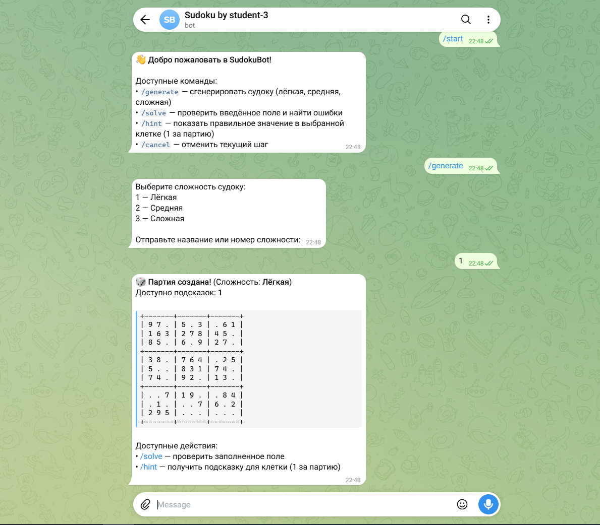
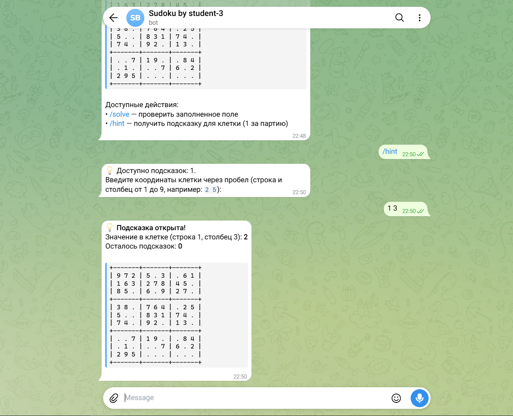
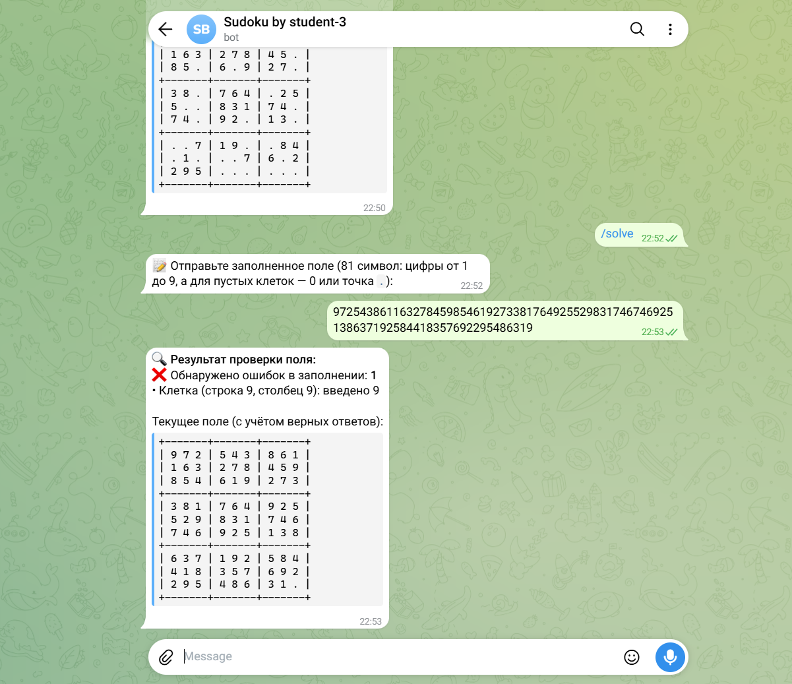
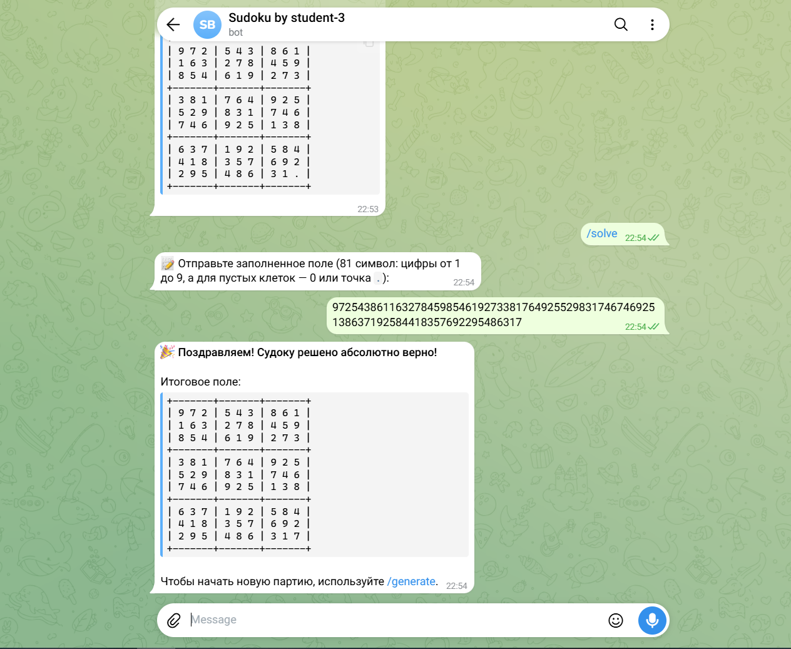

# SudokuBot - Telegram-бот для игры в Судоку

Telegram-бот для генерации головоломок Судоку различных уровней сложности, пошагового получения подсказок и проверки пользовательских решений. Пошаговые сценарии реализованы с помощью конечного автомата (FSM) с независимым хранением сессий для каждого пользователя.

## Описание функциональности

* /start, /help - вывод приветствия и списка доступных команд.
* /generate - генерирует судоку выбранной сложности (лёгкая, средняя, сложная), отображает поле в текстовом виде и сохраняет текущую партию.
* /solve - принимает введённое поле (81 символ), проверяет его корректность, показывает наличие и координаты ошибок в заполнении, а также предлагает подсказку для одной ячейки. После попытки решения (если есть ошибки или пустые клетки) выводит обновленное поле с верно угаданными числами.
* /hint - показывает правильное значение в выбранной клетке (доступна 1 подсказка за партию) и считает оставшиеся подсказки. Не тратится при выборе уже открытой клетки. Автоматически завершает игру, если открывается последняя пустая клетка.
* /cancel - отменяет текущий пошаговый ввод и возвращает пользователя к активной партии.

## Требования и запуск проекта

### 1. Установка зависимостей

```bash
npm install

```

### 2. Настройка переменных окружения

Создайте файл .env в корне проекта (на основе .env.example) и укажите токен вашего Telegram-бота:

TELEGRAM_BOT_TOKEN=ваш_токен_от_BotFather

### 3. Проверка кода и тестирование

```bash
# Проверка код-стайла (ESLint)
npm run lint

# Автоматическое исправление ошибок линтера
npm run lint:fix

# Запуск модульных тестов
npm test

# Запуск тестов с проверкой покрытия (Coverage)
npm run test:coverage

```

### 4. Запуск приложения

```bash
# Обычный запуск
npm start

# Запуск в режиме разработки с автоперезапуском
npm run dev

```

## Примеры работы





