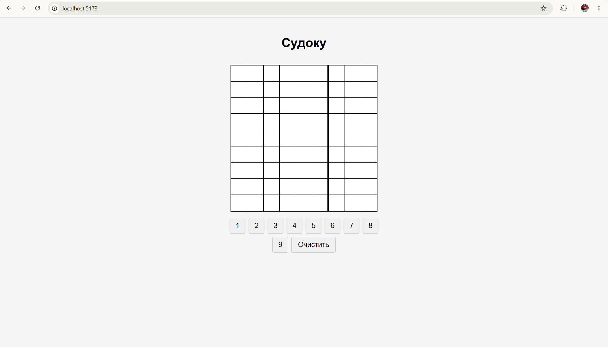
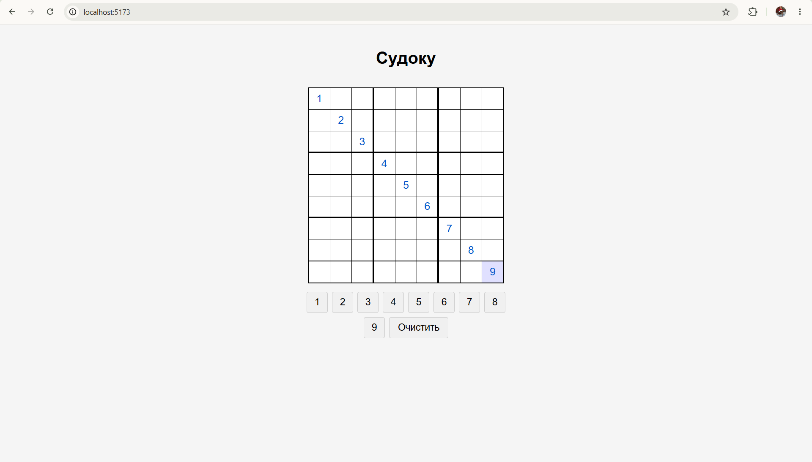
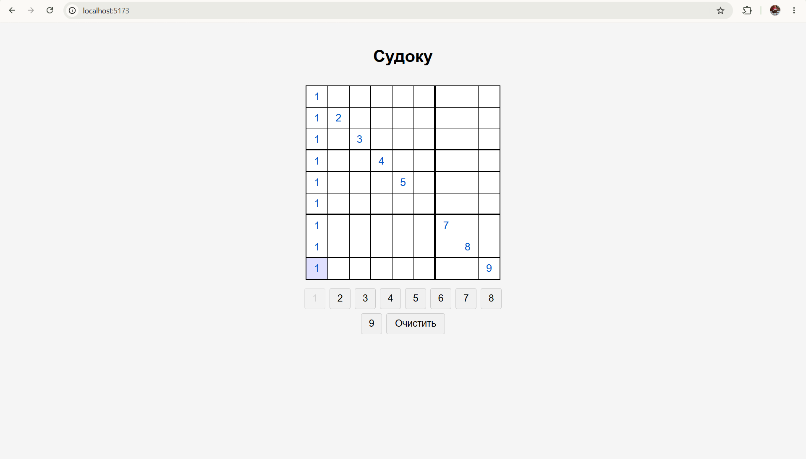

# Sudoku UI & Web App

Монорепозиторий, включающий независимую UI-библиотеку компонентов для игры в Судоку и презентационное веб-приложение. Проект разработан на React 19 и TypeScript, сборка осуществляется с помощью Vite.

## Скриншоты





## Структура проекта

Проект разделен на две изолированные части:

* **`ui-library`** — библиотека компонентов (`SudokuGrid` и `NumberPanel`). Имеет независимую сборку в формате ES-модулей, покрыта юнит-тестами и содержит собственную изоляцию стилей (CSS Modules).
* **`frontend`** — презентационное веб-приложение, демонстрирующее работу компонентов из `ui-library`. 

## 🛠 Стек технологий

* **Ядро:** React 19, TypeScript
* **Сборка:** Vite, vite-plugin-dts
* **Тестирование:** Jest, React Testing Library, jsdom
* **Линтинг:** ESLint (строгие правила форматирования, отступы 2 пробела, без `;`, строгий порядок импортов)
* **Стилизация:** CSS Modules

## 🚀 Быстрый старт

Так как `frontend` зависит от `ui-library`, библиотеку необходимо установить и собрать в первую очередь.

### 1. Сборка библиотеки
```bash
cd ui-library
npm install
npm run build

```

### 2. Запуск приложения

```bash
cd ../frontend
npm install
npm run dev

```

После запуска приложение будет доступно по адресу, указанному в терминале (обычно `http://localhost:5173/` или `http://127.0.0.1:5173/`).

## Доступные скрипты

Команды идентичны для обеих папок (`ui-library` и `frontend`):

* `npm run dev` — запуск локального dev-сервера (только для фронтенда).
* `npm run build` — строгая проверка типов (`tsc -b`) и продакшен-сборка через Vite.
* `npm run lint` — запуск линтера для проверки синтаксиса и стилистики кода.
* `npm run lint:fix` — автоматическое исправление ошибок линтера (отступы, импорты, кавычки).
* `npm run test` — запуск юнит-тестов Jest.
* `npm run test:coverage` — запуск тестов с генерацией отчета о покрытии кода (coverage > 90%).
